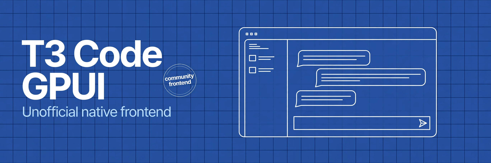
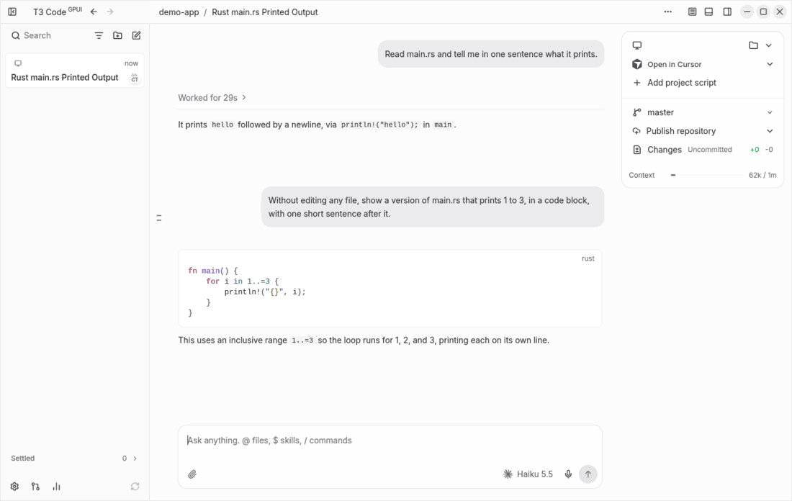
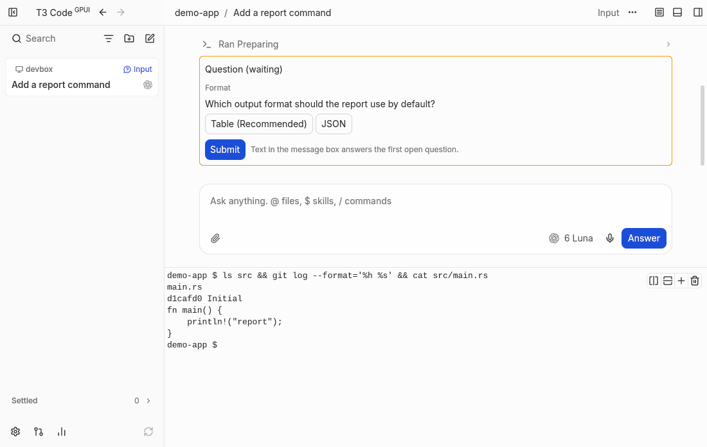
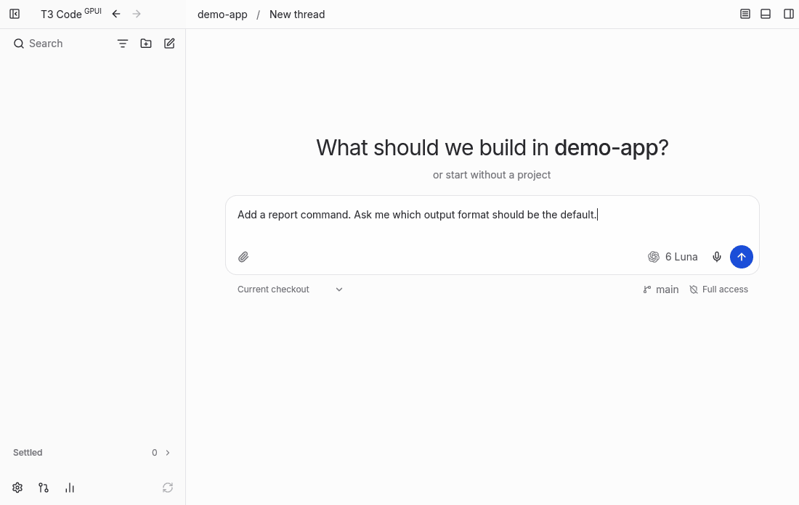
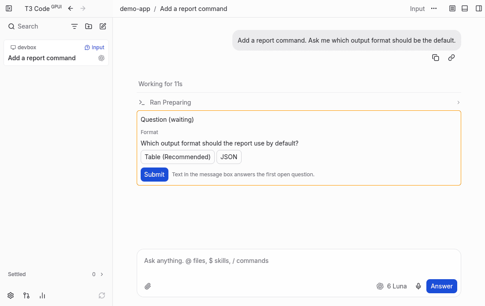

<p align="center">
  
</p>

<p align="center"><strong>An unofficial native desktop frontend for T3 Code servers, built with GPUI</strong></p>

<p align="center">
  <a href="https://github.com/conao3/rust-t3code-gpui/actions/workflows/ci.yml"></a>
  <a href="LICENSE"></a>
  <a href="Cargo.toml"></a>
  <a href="https://github.com/conao3/rust-t3code-gpui/stargazers"></a>
</p>

<p align="center">
  <a href="#layout">Layout</a> ·
  <a href="#setup">Setup</a> ·
  <a href="#usage">Usage</a> ·
  <a href="#development">Development</a> ·
  <a href="#license">License</a> ·
  <a href="THIRD_PARTY_NOTICES.md">Third-party notices</a>
</p>

# T3 Code GPUI (Unofficial)

**This is an independent, unofficial project. It is not affiliated with, endorsed by, or maintained by T3 Code, T3 Tools Inc., or the upstream T3 Code team.**

T3 Code GPUI is a native desktop frontend for [T3 Code](https://github.com/pingdotgg/t3code), built with GPUI through [gpui-kit](https://github.com/longbridge/gpui-kit). It talks to unmodified `t3 serve` servers over T3's WebSocket protocol (orchestration protocol 2) and renders the sidebar, a thread's timeline, the composer, the right panel with Git and Lineage, and a terminal drawer.

Redraws are batched: stream updates land in the client state as they arrive, and the window repaints at most every 250 ms. A streaming assistant message is split into blocks at blank lines, so only its last block is re-laid out. On X11 the window presents frames without waiting for vblank, so a frame never holds up key input (see `THIRD_PARTY_NOTICES.md` for the patched `gpui-pre-linux`).

## Layout

- `crates/t3-client`: the RPC connection, the shell and thread projections, the live subscriptions with reconnect and `afterSequence` resume, and the command helpers. No UI dependency.
- `crates/t3-terminal`: the terminal engine. It runs the Ghostty VT module (WebAssembly, through wasmtime), converts keyboard and mouse input, and attaches to terminal sessions on the server. No UI dependency.
- `crates/t3code-gpui`: the window and the CLI.

## Setup

Each server needs a bearer token. On the server's host, with the server running:

```sh
t3 auth session issue --ttl 365d --label t3code-gpui --token-only
```

Put the servers in `~/.config/t3code-gpui/environments.json` (mode 600):

```json
{
  "environments": [
    { "label": "local", "httpBaseUrl": "http://127.0.0.1:3774", "token": "..." },
    { "label": "remote", "httpBaseUrl": "https://remote.example.ts.net:8443", "token": "..." }
  ]
}
```

## Usage

```sh
nix run                                   # open the window
t3code-gpui environment list-environments
t3code-gpui environment check-environment --label local
```

<p align="center"></p>

The screenshots in this README show demo projects on temporary `t3 serve` servers, in the light theme.

The application draws its own title bar, combining navigation and window controls. Drag the title or an empty area of the bar to move the window, double-click to maximize or restore, and use the buttons at the right to minimize, maximize, or close.

The "Toggle terminal drawer" button in the title bar opens the terminal drawer, a shell that runs on the thread's server.

<p align="center"></p>

<p align="center"></p>

The first environment is the primary host. A new thread in a project that several hosts share starts on the first host that has it. It takes the project's default model, or else the model of the project's latest thread, and the runtime mode of the latest thread (full access when the project has none).

| Key | Action |
|---|---|
| Ctrl+Enter | Send the composer text (queued while the thread is working), answer the open question, or start the new thread |
| Alt+O | Open the next thread that is Done or waiting for input |
| Alt+P / Alt+N | Jump to the previous / next user message |
| Ctrl+Shift+] / Ctrl+Shift+[ | Open the next / previous thread in the sidebar |
| Ctrl+Shift+S, Alt+S | Settle the thread and open the next unsettled one (unsettle a settled thread) |
| Ctrl+Shift+O | Start a new thread (Ctrl+N too, outside the composer) |
| Escape | Leave the new-thread pane |

<p align="center"></p>

Approval and question cards in the timeline take a click. Text in the composer answers the first open question that takes free text. The host chips above the thread list show one host's threads. A thread that becomes Done or starts waiting for input raises a desktop notification, unless it is the thread open in the focused window. "Open in browser" opens the same thread in the server's web UI.

## Development

```sh
nix develop
make check        # nix fmt --ci, clippy, unit tests
make integration  # runs t3-client against a temporary `t3 serve` (needs `t3` on PATH)
```

## License

Licensed under the [Apache License 2.0](LICENSE). Third-party code and assets retain their respective licenses; see [THIRD_PARTY_NOTICES.md](THIRD_PARTY_NOTICES.md).
